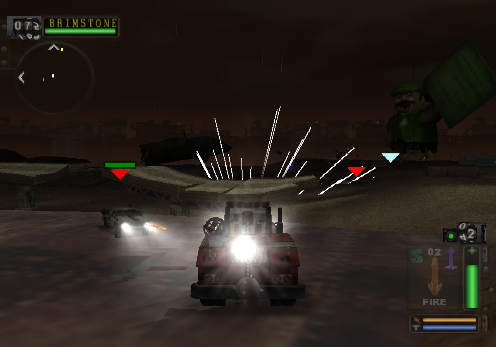
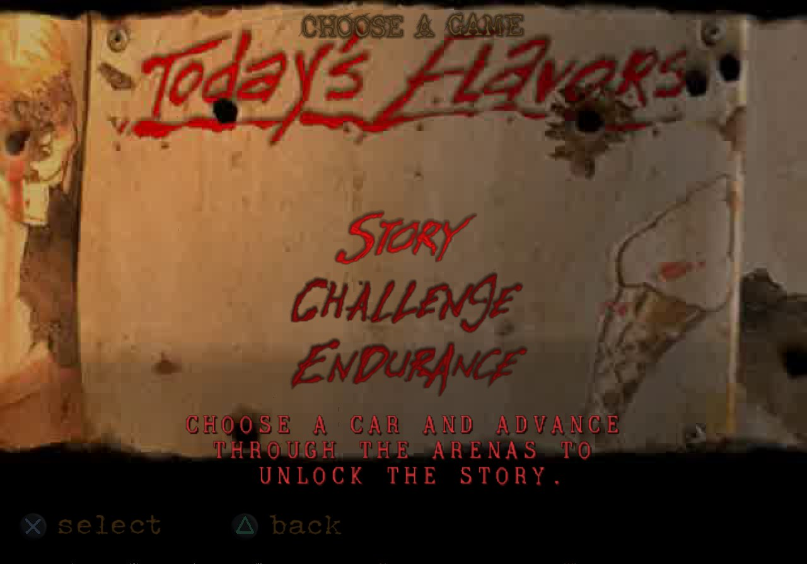

<div align="center">

# TMB_Recomp

**A native Linux and Windows port of *Twisted Metal: Black* (USA `SCUS-97101` and PAL `SCES-50360`): the whole game recompiled to C++ and run on the PC itself.**<br>
Not an emulator. The game's MIPS code (EE), its sound driver (IOP) and its VU1 microcode all run as native code; its 3D is
drawn by a PC renderer from the game's own meshes, matrices and textures, everything else it sends the GS is translated
into OpenGL draws, its frames are paced and its sound mixed on the PC's clock.


</div>

> [!IMPORTANT]
> No game files are included: no ELF, IRX modules, data archives, or code generated from them.
> You need **your own copy** of the game: the USA release, PS2 ID **`SCUS-97101`** (the default, the more complete one: the
> characters' story cinematics after choosing a character; the European disc's are about a tenth of their size), or the European one, **`SCES-50360`**. The port is built against their executables:
>
> | Release | File | SHA-1 |
> |---|---|---|
> | USA | `SCUS_971.01` | `3ff17f4897552e355d0bb8c3abfa5125fe3ff2ef` |
> | Europe | `SCES_503.60` | `d097dd85167b6a188bf5ec17ecfc53a1f275a581` |

## Status

Picking the work up elsewhere: [`docs/HANDOFF.md`](docs/HANDOFF.md) (state, how to measure, next steps).

**Playable, at full speed, as a native port: the USA release at NTSC's 60 frames per second, the European one at PAL's
50.** The game boots, runs its own IOP modules, shows the PAL language selection (Europe), plays the movies with their
sound, goes through the menus and level loading, and plays matches
and story levels: driving, weapons, bots, HUD, music and effects, deaths, respawns, saving and loading. With the native
path (`scripts/run_native.sh`, at twice the PS2's resolution) a match runs at 58.9 fps on average on the USA release
(10th percentile 58.5) and 49.4 on the European one (10th percentile 49.3), on a Ryzen 7 7800X3D with an RTX 5070 Ti. Still being checked: every arena and story level to the endings, and some effects against the PS2 picture
(issues found while playing are fixed as they come: [docs/RECOMP_NOTES.md](docs/RECOMP_NOTES.md)).

<p align="center">
  
  
  
  
</p>
<p align="center"><sub>The USA release on the native path (<code>scripts/run_native.sh</code>), drawn at twice the PS2's resolution.</sub>
</p>

| Milestone | |
|---|:---:|
| Map and recompile the main ELF (3,572 functions, symbols intact) | ✅ |
| Link the generated code with the PS2Recomp runtime on Linux and Windows | ✅ |
| Boot: EE kernel, the game's own IOP modules, CD reads from the disc files | ✅ |
| USA release (SCUS-97101, NTSC 60 Hz) alongside the European one (SCES-50360), one runtime for both | ✅ |
| Language selection screen (PAL) | ✅ |
| Controller input; every button and stick direction rebindable to keys, controllers and the mouse (F2, `input.ini`) | ✅ |
| Movies (PSS, MPEG-2 decoded with FFmpeg) | ✅ |
| Title screen and main menu | ✅ |
| Memory card: save, load, overwrite (`mc0`, `mc1` in the disc folder) | ✅ |
| Story mode: level 1 of 8 cleared (Junkyard, Midtown Suburbs), progress saved and loaded | ✅ |
| Menus, level select, level loading | ✅ |
| First match: HUD, cars, textured 3D, bots | ✅ |
| Deaths, respawns, game over and replay | ✅ |
| Full speed (60 fps USA, 50 fps Europe): native renderer, VU1 microcode as native code | ✅ |
| Frames paced on the PC's clock, not on the PS2's vblanks | ✅ |
| Sound and music (989SND, movie audio) | ✅ |
| Sound driver (989SND, LIBSD) recompiled, mixed on the PC's clock (not tied to the frame rate) | ✅ |
| Every VU1 draw native (translated programs plus the VU1 sandbox) | ✅ |
| No GS emulation: menus, HUD, 2D and movies translated into OpenGL draws (the fork's GS native back end, no paraLLEl-GS) | ✅ |
| Multi-player split screen (two controllers; `PS2X_PAD2_SCRIPT` for a scripted player 2) | ✅ |
| Every arena and story level to the endings | 🔧 |
| Higher internal resolution (`PS2X_GS_SCALE`, 2x by default) | ✅ |
| Widescreen, frame rates above the PS2's | ⏳ |

✅ works · 🔧 in progress · ⏳ not reached yet

[docs/RECOMP_NOTES.md](docs/RECOMP_NOTES.md) records how the port is brought up, every fix and how it was found, and
what remains open.

## Goal

A fully playable *Twisted Metal: Black* as a true PC program, from the intro to the endings: no PS2 hardware simulated
where the PC can do the job itself. Accuracy first; then widescreen and frame rates above the PS2's.

## How it works

The port started as a static recompilation on a reimplementation of the PS2 hardware, and is becoming a native PC
program piece by piece. Each piece below replaces a part of the PS2 that was simulated:

| Part of the game | On the PS2 | In the port |
|---|---|---|
| Frame timing | the vblank interrupt; the game counts the fields a frame took from a hardware timer | each frame paced on the PC's clock (the fork's `FramePacer`) and shown as soon as it ends, its fields counted from the real time it took (`TMB_NATIVE_FRAMES=0`: the vblanks) |
| Game code (EE, MIPS R5900) | the EE CPU | 3,572 functions recompiled to C++ (`generated/`), with the ELF's own symbols |
| Sound driver (IOP: 989SND, LIBSD) | R3000A code on the IOP | recompiled to C++ by the fork's `tools/iop_recomp.py` (`scripts/iop_recomp.sh`, `PS2X_IOP_NATIVE=1`) |
| Sound mixing (SPU2) | the SPU2 chip, at the IOP's pace | mixed when the PC's audio device asks (`PS2X_SPU2_WALLCLOCK=1`), with the IOP on the PC's clock (`PS2X_IOP_WALLCLOCK=1`): the sound no longer slows down with the frame rate |
| 3D (hier renderer: terrain, buildings, cars, characters) | VU1 microprograms, then the GS | read from the game's own data as it is sent (meshes, matrices, lights, materials) and drawn by the native renderer (`runtime/tmb_native.cpp`, `TMB_NATIVE=1`); VU1 does not run them |
| Skinned characters, sprites, rain, fog, blending | VU1, GS | translated into the native renderer's terms (bones, fog factor, blend modes) |
| Other VU1 programs (particles, billboards, beams) | VU1 | run on the PC by a VU1 sandbox on the adapter's copy of VU memory, their GS packets drawn natively: every VU1 draw of a match is native |
| Textures | GS memory | decoded on the PC from the game's own uploads, palettes included |
| Menus, HUD, 2D, movies, everything else sent to the GS | GS, IPU | translated into OpenGL draws by the fork's GS native back end (no GS emulation, no paraLLEl-GS), the native 3D drawn into the same render targets in stream order; movies decoded with FFmpeg |

```
disc files (game_us/, game/) ──► ps2_analyzer ──► recomp/tmb_scus97101.toml, tmb_sces50360.toml (+ recomp/tmb_manual.toml)
                                           │
                     ps2_recomp + the ELF's own symbol table ──► C++ (one file per function, generated/)
   989SND, LIBSD as the IOP loads them ──► iop_recomp.py ──► C++ (generated/iop/)
                                           │
                 CMakeLists.txt ──► PS2Recomp runtime + generated code + runtime/ (TMB's overrides, native adapter)
                                           │
   native renderer · VU1 sandbox · texture cache · SPU2 mixer on the PC clock ─┼─► ps2EntryRunner
   GS native back end (the GS stream as OpenGL draws) · window presentation on the GPU, at 2x
   what is left of the PS2: EE kernel HLE · DMAC · GIF / VIF packet handling · IPU · IOP kernel and other modules
```

- **Both regions, one runtime.** `TMB_REGION=us` (the default) or `pal` picks the disc folder (`game_us/`, `game/`), the
  recompiler config, the generated code (`generated_us/`, `generated/`) and the build (`build/game_us`, `build/game`).
  Everything hand-written is shared: `runtime/` is written against the PAL executable and marks the addresses it uses
  (`TMB_ADDR`, `TMB_GP`); `tools/tmb_region_map.py` maps them to the region's executable by symbol (a file's statics
  through the code that uses them) into `tmb_region.h`, and `recomp/tmb_manual.toml` holds the recompiler's hand-written
  settings by symbol name. The two executables differ little (the US one is five months older); NTSC draws a 640 x 224
  field instead of 640 x 256, which the native renderer follows.
- Both executables ship their full symbol table (3,572 named functions, `.mdebug`), so no Ghidra pass is needed:
  `ps2_analyzer` reads the symbols, recognises the Sony SDK functions that have runtime handlers and writes the config.
- PS2Recomp turns every function into C++ and emits the address-indexed function table.
- `runtime/tmb_native.cpp` is TMB's native adapter: it reads every VIF1 stream the game sends and draws it natively,
  and tells VU1 which programs to skip. The generic parts live in the fork (`ps2xRuntime/src/lib/native/`: renderer,
  texture cache, VU1 sandbox, GIF translation; `docs/native.md`), shared with the other ports.
- `runtime/tmb_overrides.cpp` holds the other game-specific bindings.

The PS2Recomp fork lives in `PS2Recomp/` (git submodule, [boubou666/PS2Recomp](https://github.com/boubou666/PS2Recomp)),
shared with the other recompilations built on it (*Valkyrie Profile 2*, *Drakengard*, *The Lord of the Rings: The Third
Age*, *Jade Cocoon 2*, *Soulcalibur III* and others). Fixes made for this port land there.

## Requirements

- Linux (developed on Arch) or Windows 10/11 with [MSYS2](https://www.msys2.org/) (UCRT64, see below)
- CMake 3.21+, Ninja, GCC 13+ or Clang with C++20
- FFmpeg development libraries (`libavcodec`, `libavformat`, `libavutil`, `libswresample`, `libswscale`) and `pkg-config`
- X11/Wayland and OpenGL development headers (raylib is fetched and built by the fork)
- `bsdtar` (libarchive) to extract the disc
- A CPU with AVX2 (the runtime is built for `x86-64-v3`)
- Your own copy of `SCUS-97101` or `SCES-50360` (check the hash above)

## Build and run

```bash
git clone --recurse-submodules https://github.com/boubou666/TMB_Recomp.git
cd TMB_Recomp
scripts/extract_iso.sh "/path/to/Twisted Metal - Black (USA).iso"      # disc files -> game_us/ (TMB_REGION=pal: the European disc -> game/)
scripts/build_tools.sh                                                  # ps2_recomp, ps2_analyzer, ps2_vu_aot -> build/tools
scripts/recomp.sh                                                       # ELF + recomp/tmb_scus97101.toml -> generated_us/ (VU1 microcode -> generated_us/vu1/)
scripts/build_runtime.sh                                                # runtime + generated code -> build/game_us
scripts/iop_recomp.sh                                                   # optional: boots once to recompile the sound driver -> generated_us/iop/, then rebuild
scripts/run_native.sh                                                   # the native port (native renderer, recompiled sound driver, sound on the PC clock)
scripts/run.sh                                                          # the PS2 path only (VU1 and GS simulated), for comparison
scripts/pgo.sh                                                          # optional, experimental: profile-guided rebuild (~200 s of scripted play)
```

### Windows

The same scripts run in an MSYS2 **UCRT64** shell, with MSYS2's GCC (MSVC is not supported for this port).

```bash
pacman -S --needed mingw-w64-ucrt-x86_64-{gcc,cmake,ninja,pkgconf,ffmpeg,libarchive,python} git rsync
git clone --recurse-submodules https://github.com/boubou666/TMB_Recomp.git
```

Then follow the steps above. `scripts/stage_dlls.sh` copies the DLLs the runner needs next to
`ps2EntryRunner.exe`, so it can also be started outside the MSYS2 shell. The native port draws with OpenGL 3.3; the
PS2 path (`scripts/run.sh`) draws the GS with paraLLEl-GS, which needs a Vulkan driver (any recent NVIDIA, AMD or Intel
driver ships one).

`scripts/regress.sh <build-dir> <out-dir>` is the fork's port regression run for TMB: boot movies, menus and a
Skyscrapers match under the bench lock, with a `summary.txt` (route reached, exit, fps mean and p10, frames over 25 ms,
errors) and the last frame.

`scripts/analyze.sh` regenerates the TOML from scratch; it discards manual edits, so diff before committing.
The runner build compiles about 70 MB of generated C++ and takes a while the first time.

Run the game with the extracted disc folder as `cdrom0:` (that is what `scripts/run.sh` does):

```bash
build/game_us/PS2Recomp/ps2xRuntime/ps2EntryRunner game_us/SCUS_971.01
```

Player 1 plays with the keyboard and the first controller, player 2 with the second controller. The default keys (US
key positions):

| PS2 button | Keyboard |
|---|---|
| D-pad | Arrow keys or W A S D |
| Cross / Circle / Square / Triangle | X or Space / C or Esc / Z or Numpad 0 / V or Numpad 1 |
| L1 / R1 / L2 / R2 | Q / E / Left Shift / Right Shift |
| Start / Select | Enter / Tab |
| L3 / R3 | F / G |
| Left stick / right stick | the movement keys (with the D-pad) / I J K L |

| Key | What it does |
|---|---|
| F1 | Runtime debugger |
| F2 | Controls: rebind every PS2 button and stick direction, per player, to keys, controller buttons, sticks and triggers, mouse buttons, the wheel or mouse movement (sensitivity, invert Y, cursor capture). Saved to `input.ini` in the disc folder (`game_us/input.ini`; `PS2X_INPUT_CONFIG=<file>` for another place). |

<details>
<summary><b>Runtime and diagnostic options</b></summary>

| Variable | Effect |
|---|---|
| `TMB_NATIVE=1` | The native renderer draws TMB's 3D from its own data (`scripts/run_native.sh` sets it) |
| `TMB_NATIVE_FRAMES=0` | Frames on the emulated vblanks instead of the PC clock |
| `PS2X_GS_SCALE=<n>` | With `TMB_NATIVE=1`: the internal resolution, n times the PS2's each way (1 to 4, default 2) |
| `PS2X_WINDOW_SIZE=<w>x<h>` | The window's size when it opens |
| `TMB_NATIVE_SANDBOX=0` | The VU1 programs the adapter does not translate stay on VU1 and the GS (default: the VU1 sandbox runs them, drawn natively) |
| `TMB_NATIVE_VU1=1` | VU1 runs the translated programs too (the GS frame then has everything, to compare) |
| `TMB_NATIVE_VU1_PCS=<pc,...>` / `TMB_NATIVE_SANDBOX_PCS=<pc,...>` | Leave those setups on VU1 / run translated ones on the sandbox (to compare a program with VU1) |
| `PS2X_NATIVE_VIEW=only` | Show the native frame alone, without the GS one under it |
| `PS2X_NATIVE_INTERPOLATE=1`, `PS2X_PRESENT_FPS=<n>` | Draw frames between the game's 50 (objects interpolated), presented at up to n per second |
| `PS2X_IOP_NATIVE=1` | Run the recompiled sound driver (`scripts/iop_recomp.sh` generates it) |
| `PS2X_SPU2_WALLCLOCK=1`, `PS2X_IOP_WALLCLOCK=1` | Mix the sound when the audio device asks, and run the IOP on the PC's clock |
| `PS2X_CAPTURE_DIR=<dir>`, `PS2X_CAPTURE_INTERVAL=<s>` | Save the presented frame every few seconds (works minimized) |
| `PS2X_PAD_SCRIPT=t:BUTTON[/ms],…` | Scripted button presses (seconds from start), for unattended runs |
| `PS2X_VU1_RECORD=<file>` | Record VU1 microprogram runs for `ps2_vu1_replay` / `build/game/tmb_vu1_replay` (with the compiled microcode; the default fast VU1 path differs in cycle counts only, `TMB_VU1_EXACT=1 scripts/recomp.sh` for the exact one) |
| `PS2X_VU_AOT=0` | Interpret the VU1 microcode instead of running the compiled one |
| `TMB_VBLANK_HOLD=<ms>` | With `TMB_NATIVE_FRAMES=0`: hold the vblank up to <ms> while a match frame finishes (default 6; 0 off); `TMB_VBLANK_HOLD_AB=1` compares on/off in one run |
| `TMB_ENEMY_HEALTH_CAP=<x>` | Testing: hold the opponents' health at most x (a scripted run can win its matches) |
| `TMB_KILL_ENEMIES=<s>` | Testing: every <s> seconds every opponent alive takes a killing hit through the game's own damage function (the kill counts; scripted story runs) |
| `TMB_AB=<hold\|slice\|lag\|holdlimit\|fill>` | In-run A/B of an experiment, on and off every 100 vblanks, real-time fps and game speed per mode |
| `TMB_PLAYER_HEALTH_CAP=<x>` | Testing: hold the player car's health at most x (game over within minutes of play) |
| `TMB_PLAYER_GOD=1` | Testing: the player car's health goes back to its highest value every frame (story walkthroughs) |
| `PS2X_VU_LIFTED=0` | Run the compiled microcode instead of the loops lifted to native code (the rain, `runtime/vu1`) |
| `PS2X_VU1_RECORD_PC=<pc>` | With `PS2X_VU1_RECORD`: only the microprogram runs starting at that pc |
| `TMB_MAX_FRAME_MS=<ms>` | Longest frame weapons and debris move over (default 40; slow motion below 25 fps) |
| `TMB_SUBSTEPS=<n>` | Run the game update once per vblank field, up to n times a frame, so cars do not go through the ground below 50 fps (default 4, 1 disables) |
| `TMB_TRACE_FRAMES=1` | Every 100 frames: frame time split, EE idle and VIF1/GS waits, CPU ms per frame of each host thread |
| `TMB_TRACE_TIMELINE=<file>` | 4 s of the match as a timeline (game events, game/vif1/gs thread CPU every 0.2 ms) for `tools/timeline.py` |
| `PS2X_IOP_THREAD=1` | Run the IOP on its own thread (experimental, slower in TMB today) |
| `PS2X_SHOW_FPS=0` | Hide the frame rate counter at the top right (on by default; F3 toggles it while playing) |
| `PS2X_GS_RENDERER=parallel` / `cpu` | The emulated GS instead of the GS native back end: paraLLEl-GS (Vulkan; the default without `TMB_NATIVE=1`) or the CPU rasterizer |
| `TMB_TRACE_POS=<file>` | Every vehicle's position at each collision pass (`scripts/bots.sh` and `tools/falls.py` count the falls) |
| `TMB_TRACE_BLACKBOX=<file>` | Dump the player vehicle's last 64 frames when its position goes wild |
| `TMB_GS_SERIAL=1` | Rasterize on the GS thread alone (default: 4 rasterization workers, `PS2X_GS_RASTER_THREADS=<n>`) |
| `TMB_VIF1_SERIAL=1` | Run VIF1 and the VU1 microcode on the game thread (default: their own thread) |
| `TMB_GS_LAG=1` | Let the GS and VU1 finish a frame while the game runs the next (one frame of extra input latency, no measurable gain; off by default) |
| `PS2X_GS_RECORD=<file>`, `PS2X_GS_RECORD_AT=<s>`, `PS2X_GS_RECORD_SECONDS=<s>` | Record the GS command stream for `ps2_gs_replay` (rasterizer timing, VRAM hash) |
| `PS2X_GS_DUMP=<dir>`, `PS2X_GS_DUMP_AFTER=<s>`, `PS2X_GS_DUMP_COUNT=<n>` | Log the next GS primitives with their state, decoded textures and VRAM |
| `PS2X_GS_SYNC=1` | Rasterize on the game thread instead of the GS worker threads |
| `PS2X_GS_LOG_LIMIT=<n>` | Raise the cap on the `[gs:gif]`/`[gs:reg]` diagnostic logs |
| `TMB_ISO=<path>` | Disc image for raw `sceCdRead` calls (default: the `.iso` above the disc folder that boots the executable) |
| `TMB_TRACE_MOVIE=1` | Log the movie player's thread teardown, audio state and MPEG HLE summary |
| `TMB_TRACE_THREADS=<s>` | Every few seconds: guest threads, MPEG HLE state, GS display registers (`TMB_TRACE_IOP=1` adds IOP threads) |
| `PS2X_IOP_TRACE_RPC=1` | Log IOP RPC dispatch and blocking calls |

</details>

## Disc facts

| | |
|---|---|
| Boot ELF | `SCUS_971.01` (USA, May 2001) / `SCES_503.60` (Europe, October 2001), entry `0x100008`, `.text` at `0x100000` (1.2 MB), not stripped |
| Video mode | NTSC (USA), PAL (Europe) |
| IOP modules | `MOD/*.IRX`: 989SND, LGDEV, LIBSD, MCMAN, MCSERV, MTAPMAN, PADMAN, SIO2MAN, SNDBGET, USBD, USBKEYBD, USBMLOAD |
| IOP image | `IOPRP213.IMG` |
| Data | `LVL/`, `PCAR/`, `ACAR/`, `PTS/`, `RST/`, `SND/`, `VAG/`, `SHELL/` (per-language UI), `MOV/*.PSS` |

## Repository layout

| Path | Contents |
|---|---|
| `recomp/` | Recompiler config (analyzer output plus manual additions) |
| `runtime/` | Game override module (game-specific bindings) |
| `scripts/` | Extract, build tools, analyze, recomp, build runner, run |
| `tools/` | Analysis helpers (`iso_lbn.py`: disc file of a sector; `gs_fb_decode.py`: framebuffer out of a VRAM dump; `irx_disasm.py`: IOP module code) |
| `docs/` | Bring-up notes |
| `PS2Recomp/` | PS2Recomp fork (submodule) |

Everything derived from the game (`game_us/`, `game/`, `generated_us/`, `generated/`, `build/`, disc images, captures) is git-ignored. Never commit or
redistribute it.

## Credits

- [PS2Recomp](https://github.com/ran-j/PS2Recomp) by ran-j and contributors (GPL), the recompiler and runtime this port is built on.
- The *Valkyrie Profile 2: Silmeria* and *Drakengard* recompilations, developed on the same PS2Recomp fork; runtime fixes are shared.
- *Twisted Metal: Black* © Sony Interactive Entertainment, developed by Incognito Entertainment. This is an unofficial fan project, not affiliated with or endorsed by them.
