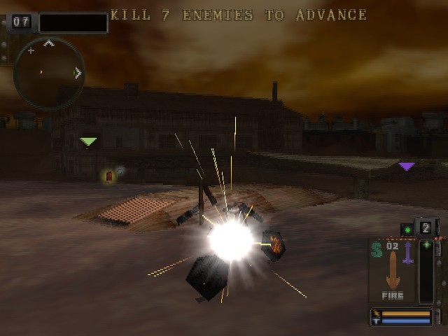
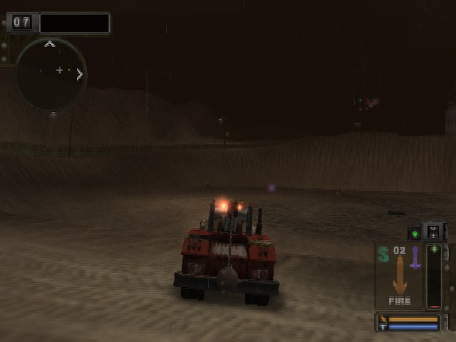
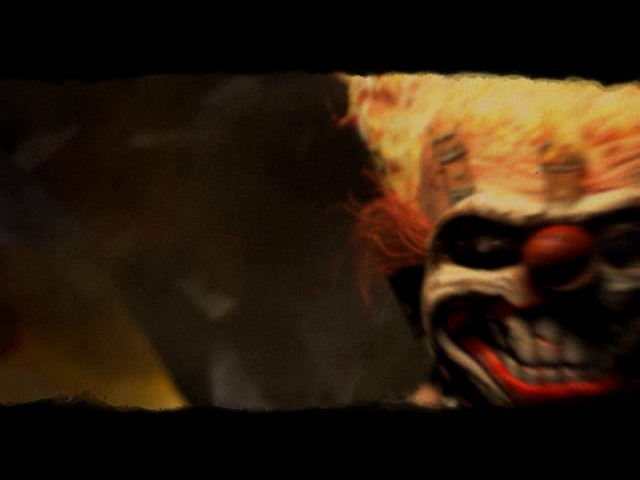
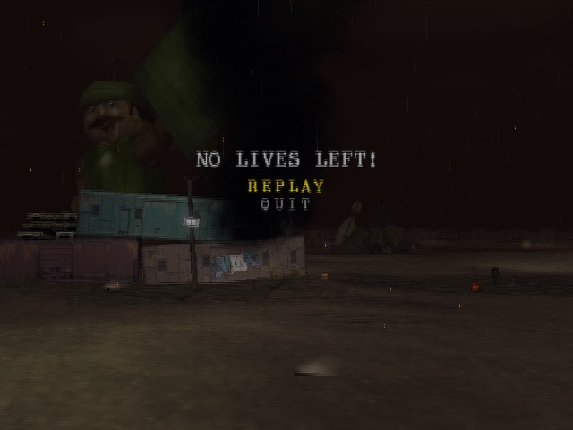

<div align="center">

# TMB_Recomp

**A native Linux and Windows port of *Twisted Metal: Black* (PAL, `SCES-50360`), made by statically recompiling the game's PlayStation 2 code to C++.**<br>
Not an emulator: the game's own MIPS R5900 code, rebuilt as a native program on a reimplementation of the PS2 hardware.


</div>

> [!IMPORTANT]
> No game files are included: no ELF, IRX modules, data archives, or code generated from them.
> You need **your own copy** of the PAL release, PS2 ID **`SCES-50360`**. The port is built against that disc's executable:
>
> | File | SHA-1 |
> |---|---|
> | `SCES_503.60` | `d097dd85167b6a188bf5ec17ecfc53a1f275a581` |

## Status

Picking the work up elsewhere: [`docs/HANDOFF.md`](docs/HANDOFF.md) (state, how to measure, next steps).

**Work in progress: the first match is playable.** The game boots, runs its own IOP modules, shows the PAL language
selection, plays the movies with their sound, goes through the menus and level loading, and runs the first match:
driving, weapons, bots, HUD, music and effects, deaths, respawns and the game-over menu. It runs at about 45 frames
per second on average on a Ryzen 7 7800X3D with the GPU renderer (35-39 in the busiest moments), short of the PAL
50; the other arenas, story mode and saving are not checked yet.

<p align="center">
  
  
  
  
</p>

| Milestone | |
|---|:---:|
| Map and recompile the main ELF (3,572 functions, symbols intact) | ✅ |
| Link the generated code with the PS2Recomp runtime on Linux and Windows | ✅ |
| Boot: EE kernel, the game's own IOP modules, CD reads from the disc files | ✅ |
| Language selection screen (PAL) | ✅ |
| Controller input | ✅ |
| Movies (PSS, MPEG-2 decoded with FFmpeg) | ✅ |
| Title screen and main menu | ✅ |
| Memory card | ⏳ |
| Menus, level select, level loading | ✅ |
| First match: HUD, cars, textured 3D, bots | ✅ |
| Deaths, respawns, game over and replay | ✅ |
| Full speed (50 fps) | 🔧 |
| Sound and music (989SND, movie audio) | ✅ |
| Story mode, saving, split screen | ⏳ |
| Widescreen, higher resolution | ⏳ |

✅ works · 🔧 in progress · ⏳ not reached yet

[docs/RECOMP_NOTES.md](docs/RECOMP_NOTES.md) records how the port is brought up, every fix and how it was found, and
what remains open.

## Goal

A fully playable *Twisted Metal: Black* as a native executable, from the intro to the endings. Accuracy first; once it
is playable, widescreen and higher internal resolution.

## How it works

```
disc files (game/) ──► ps2_analyzer ──► recomp/tmb_sces50360.toml (SDK stubs, entry points, jump tables)
                                           │
                     ps2_recomp + the ELF's own symbol table ──► C++ (one file per function, generated/)
                                           │
                 CMakeLists.txt ──► PS2Recomp runtime + generated code + runtime/tmb_overrides.cpp
                                           │
   PS2Recomp runtime: EE kernel HLE · DMAC · GIF/GS · VIF/VU0/VU1 · IPU ─┼─► ps2EntryRunner
   PS2Recomp IOP:     R3000A interpreter running the game's own IRX · SPU2 · SIO2
```

- The PAL executable ships with its full symbol table (3,572 named functions, `.mdebug`), so no Ghidra pass is needed:
  `ps2_analyzer` reads the symbols, recognises the Sony SDK functions that have runtime handlers and writes the config.
- PS2Recomp turns every function into C++ and emits the address-indexed function table.
- The top-level `CMakeLists.txt` builds the fork's runtime, swaps its placeholder function table for the generated one
  and links everything into `ps2EntryRunner`.
- `runtime/tmb_overrides.cpp` holds the game-specific bindings.

The PS2Recomp fork lives in `PS2Recomp/` (git submodule, [boubou666/PS2Recomp](https://github.com/boubou666/PS2Recomp)),
shared with the *Valkyrie Profile 2* and *Drakengard* recompilations. Fixes made for this port land there, starting with
the GCC/Clang build flags for the runtime's AVX2 code.

## Requirements

- Linux (developed on Arch) or Windows 10/11 with [MSYS2](https://www.msys2.org/) (UCRT64, see below)
- CMake 3.21+, Ninja, GCC 13+ or Clang with C++20
- FFmpeg development libraries (`libavcodec`, `libavformat`, `libavutil`, `libswresample`, `libswscale`) and `pkg-config`
- X11/Wayland and OpenGL development headers (raylib is fetched and built by the fork)
- `bsdtar` (libarchive) to extract the disc
- A CPU with AVX2 (the runtime is built for `x86-64-v3`)
- Your own copy of `SCES-50360` (check the hash above)

## Build and run

```bash
git clone --recurse-submodules https://github.com/boubou666/TMB_Recomp.git
cd TMB_Recomp
scripts/extract_iso.sh "/path/to/Twisted Metal - Black (Europe).iso"   # disc files -> game/
scripts/build_tools.sh                                                  # ps2_recomp, ps2_analyzer, ps2_vu_aot -> build/tools
scripts/recomp.sh                                                       # ELF + recomp/tmb_sces50360.toml -> generated/ (VU1 microcode -> generated/vu1/)
scripts/build_runtime.sh                                                # runtime + generated code -> build/game
scripts/run.sh                                                          # ps2EntryRunner game/SCES_503.60
scripts/pgo.sh                                                          # optional, experimental: profile-guided rebuild (~200 s of scripted play)
```

### Windows

The same scripts run in an MSYS2 **UCRT64** shell, with MSYS2's GCC (MSVC is not supported for this port).

```bash
pacman -S --needed mingw-w64-ucrt-x86_64-{gcc,cmake,ninja,pkgconf,ffmpeg,libarchive,python} git rsync
git clone --recurse-submodules https://github.com/boubou666/TMB_Recomp.git
```

Then follow the steps above. `scripts/stage_dlls.sh` copies the DLLs the runner needs next to
`ps2EntryRunner.exe`, so it can also be started outside the MSYS2 shell. The GPU renderer needs a Vulkan driver
(any recent NVIDIA, AMD or Intel driver ships one).

`scripts/analyze.sh` regenerates the TOML from scratch; it discards manual edits, so diff before committing.
The runner build compiles about 70 MB of generated C++ and takes a while the first time.

Run the game with the extracted disc folder as `cdrom0:` (that is what `scripts/run.sh` does):

```bash
build/game/PS2Recomp/ps2xRuntime/ps2EntryRunner game/SCES_503.60
```

A controller is used when one is connected; otherwise the keyboard (US key positions):

| PS2 button | Keyboard |
|---|---|
| D-pad | Arrow keys or W A S D |
| Cross / Circle / Square / Triangle | X or Space / C or Esc / Z or Numpad 0 / V or Numpad 1 |
| L1 / R1 / L2 / R2 | Q / E / Left Shift / Right Shift |
| Start / Select | Enter / Tab |

| Key | What it does |
|---|---|
| F1 | Runtime debugger |

<details>
<summary><b>Runtime and diagnostic options</b></summary>

| Variable | Effect |
|---|---|
| `PS2X_CAPTURE_DIR=<dir>`, `PS2X_CAPTURE_INTERVAL=<s>` | Save the presented frame every few seconds (works minimized) |
| `PS2X_PAD_SCRIPT=t:BUTTON[/ms],…` | Scripted button presses (seconds from start), for unattended runs |
| `PS2X_VU1_RECORD=<file>` | Record VU1 microprogram runs for `ps2_vu1_replay` / `build/game/tmb_vu1_replay` (with the compiled microcode; the default fast VU1 path differs in cycle counts only, `TMB_VU1_EXACT=1 scripts/recomp.sh` for the exact one) |
| `PS2X_VU_AOT=0` | Interpret the VU1 microcode instead of running the compiled one |
| `TMB_VBLANK_HOLD=<ms>` | Hold the vblank up to <ms> while a match frame finishes (default 6; 0 off); `TMB_VBLANK_HOLD_AB=1` compares on/off in one run |
| `TMB_PLAYER_HEALTH_CAP=<x>` | Testing: hold the player car's health at most x (game over within minutes of play) |
| `PS2X_VU_LIFTED=0` | Run the compiled microcode instead of the loops lifted to native code (the rain, `runtime/vu1`) |
| `PS2X_VU1_RECORD_PC=<pc>` | With `PS2X_VU1_RECORD`: only the microprogram runs starting at that pc |
| `TMB_MAX_FRAME_MS=<ms>` | Longest frame weapons and debris move over (default 40; slow motion below 25 fps) |
| `TMB_SUBSTEPS=<n>` | Run the game update once per vblank field, up to n times a frame, so cars do not go through the ground below 50 fps (default 4, 1 disables) |
| `TMB_TRACE_FRAMES=1` | Every 100 frames: frame time split, EE idle and VIF1/GS waits, CPU ms per frame of each host thread |
| `TMB_TRACE_TIMELINE=<file>` | 4 s of the match as a timeline (game events, game/vif1/gs thread CPU every 0.2 ms) for `tools/timeline.py` |
| `PS2X_IOP_THREAD=1` | Run the IOP on its own thread (experimental, slower in TMB today) |
| `PS2X_SHOW_FPS=0` | Hide the frame rate counter at the top right (on by default; F3 toggles it while playing) |
| `PS2X_GS_RENDERER=cpu` | Draw with the CPU rasterizer. The default is the GPU (paraLLEl-GS, Vulkan), which falls back to the CPU when no Vulkan device is found |
| `TMB_TRACE_POS=<file>` | Every vehicle's position at each collision pass (`scripts/bots.sh` and `tools/falls.py` count the falls) |
| `TMB_TRACE_BLACKBOX=<file>` | Dump the player vehicle's last 64 frames when its position goes wild |
| `TMB_GS_SERIAL=1` | Rasterize on the GS thread alone (default: 4 rasterization workers, `PS2X_GS_RASTER_THREADS=<n>`) |
| `TMB_VIF1_SERIAL=1` | Run VIF1 and the VU1 microcode on the game thread (default: their own thread) |
| `TMB_GS_LAG=1` | Let the GS and VU1 finish a frame while the game runs the next (one frame of extra input latency, no measurable gain; off by default) |
| `PS2X_GS_RECORD=<file>`, `PS2X_GS_RECORD_AT=<s>`, `PS2X_GS_RECORD_SECONDS=<s>` | Record the GS command stream for `ps2_gs_replay` (rasterizer timing, VRAM hash) |
| `PS2X_GS_DUMP=<dir>`, `PS2X_GS_DUMP_AFTER=<s>`, `PS2X_GS_DUMP_COUNT=<n>` | Log the next GS primitives with their state, decoded textures and VRAM |
| `PS2X_GS_SYNC=1` | Rasterize on the game thread instead of the GS worker threads |
| `PS2X_GS_LOG_LIMIT=<n>` | Raise the cap on the `[gs:gif]`/`[gs:reg]` diagnostic logs |
| `TMB_ISO=<path>` | Disc image for raw `sceCdRead` calls (default: first `.iso` above `game/`) |
| `TMB_TRACE_MOVIE=1` | Log the movie player's thread teardown, audio state and MPEG HLE summary |
| `TMB_TRACE_THREADS=<s>` | Every few seconds: guest threads, MPEG HLE state, GS display registers (`TMB_TRACE_IOP=1` adds IOP threads) |
| `PS2X_IOP_TRACE_RPC=1` | Log IOP RPC dispatch and blocking calls |

</details>

## Disc facts

| | |
|---|---|
| Boot ELF | `SCES_503.60`, entry `0x100008`, `.text` at `0x100000` (1.2 MB), not stripped |
| Video mode | PAL |
| IOP modules | `MOD/*.IRX`: 989SND, LGDEV, LIBSD, MCMAN, MCSERV, MTAPMAN, PADMAN, SIO2MAN, SNDBGET, USBD, USBKEYBD, USBMLOAD |
| IOP image | `IOPRP213.IMG` |
| Data | `LVL/`, `PCAR/`, `ACAR/`, `PTS/`, `RST/`, `SND/`, `VAG/`, `SHELL/` (per-language UI), `MOV/*.PSS` |

## Repository layout

| Path | Contents |
|---|---|
| `recomp/` | Recompiler config (analyzer output plus manual additions) |
| `runtime/` | Game override module (game-specific bindings) |
| `scripts/` | Extract, build tools, analyze, recomp, build runner, run |
| `tools/` | Analysis helpers (`iso_lbn.py`: disc file of a sector; `gs_fb_decode.py`: framebuffer out of a VRAM dump; `irx_disasm.py`: IOP module code) |
| `docs/` | Bring-up notes |
| `PS2Recomp/` | PS2Recomp fork (submodule) |

Everything derived from the game (`game/`, `generated/`, `build/`, disc images, captures) is git-ignored. Never commit or
redistribute it.

## Credits

- [PS2Recomp](https://github.com/ran-j/PS2Recomp) by ran-j and contributors (GPL), the recompiler and runtime this port is built on.
- The *Valkyrie Profile 2: Silmeria* and *Drakengard* recompilations, developed on the same PS2Recomp fork; runtime fixes are shared.
- *Twisted Metal: Black* © Sony Interactive Entertainment, developed by Incognito Entertainment. This is an unofficial fan project, not affiliated with or endorsed by them.
